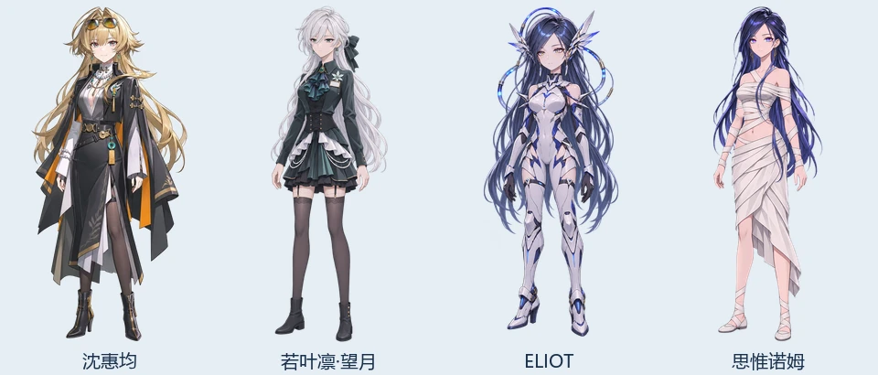
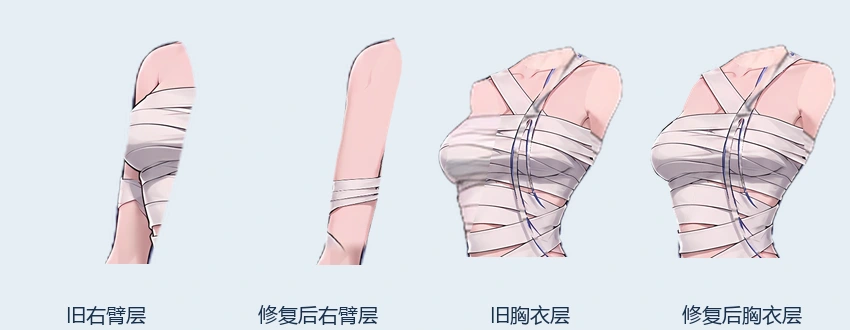

# 《源界》人物战斗立绘制作与修复

2026 年 11 月 21 日 · 美术、拆图与 Unity 接手手册

这里的「战斗立绘」指站在战场上、随动作抬手和转身的同行者。手指、绷带、披风画在谁身上，在静态合成里可能看不出差别。一旦骨骼转动，这些像素就会跟所属图层一起走。做新角色从第一节开始，修既有角色可以直接看第四节的故障表。

图中四人按冰火试用队顺序排放，分别缩放至相近的展示高度，用来看拼合、轮廓与遮挡。游戏内的身高、站位、灯光和动态由战场决定。

## 一、新角色从原画到战场

| 阶段 | 具体做法 | 做到什么程度可以往下走 |
| --- | --- | --- |
| 收素材 | 把定稿原画、PSD／透明拆件、角色 ID、出手侧放在一起对照，留存原件。注明「右臂」指角色自身右臂，并在原画上点明哪只手施法。闭眼图、头像、看板和终结技视频各有用途。 | 能指出角色最要紧的三个识别部位，例如小惟的绷带交叉线、沈惠均外套的金边、ELIOT 头侧的刃形轮廓。 |
| 定动作再拆层 | 先摆待机、抬手最高点、回收三种姿势。按这些动作决定哪些部位各自运动。常用组有前后发、头、胸、胯、腿脚、双臂；跨过手臂的披风、耳饰或武器依实际遮挡单列。 | 隐藏施法手后，能看到它让出的胸衣、腋下和内衬。露出的缺口标在相应底层，补到动作会揭开的范围。 |
| 对齐母版 | 将拆层按原图坐标还原到同一画布，记录每层原点、边界和叠放次序。用五官、肩缝、衣纹和鞋尖共同配准；白底 JPG 先检查与外边缘连通的背景区域。 | 降低上层透明度或来回切换两张图，眼线、领口、指尖和脚底没有重影。白发、白衣、鞋尖仍完整。 |
| 重贴与补背面 | 可见部位优先从已对齐的高清原画回填颜色和线条，遮挡内部保留 PSD 提供的底图。原图里从未画到的部分，先找同材质、同光向参照，只补动作会露出的区域。 | 在深浅两种底色上各看一遍，再分别移动前后两层。不能只靠原位拼起来那一张图过关。 |
| 裁切与导出 | 在公共画布上计算脚底锚点和关节，再裁每层透明边界。导出透明 PNG 和同一版本的 `rig.json`。纹理命名、坐标、层序要成套更新。 | 从导出物独立重建站姿，角色没有飞层或脚底错位。保留原画、修复用遮罩和能重做的导出步骤。 |
| 绑定与动作 | 骨盆带躯干，脚底在移重心时仍着地；肩、肘、腕分别摆动。按角色决定出手幅度、副手参与程度、发梢或衣摆跟随量。 | 无特效时也能读出起手、发力和收势。再挂上技能，最亮的一帧里手、投射物和作用方向仍对得上。 |

原图曾用透明外框粗对齐，再用灰度图细调仿射变换。旧重贴脚本会尝试把缺片分给最近图层，也有超分导出步骤。距离最近的发梢有时并不属于抬起的手；自动结果应逐部件复查。超分后的眼线、绷带细线和耳饰要与原画对照。[历史重贴工具](../cocos/tools/retexture.py)

## 二、小惟右肩为什么反复修

看第一格，旧右臂上有一大片属于躯干的胸前绷带。原位时它刚好盖住胸衣缺少的部分。转动手臂后，绷带跟着走，胸衣边缘露出来。即使把两张贴图都放大，这道断口也会随姿势出现。

1. **重新划清皮肤和衣服的归属。** 修复脚本沿原画肩线将胸前绷带归回躯干，参照对侧手臂的皮肤重建被遮住的上臂，同时保留原前臂及肩尖细节。看第二格和第四格，胸衣纹路能单独接起来，上臂也有连续的轮廓。[右肩拆分与重建](../unity/siwei_layers.py)
2. **保住裁切注册与层序。** 导出时保留旧右臂的注册边界，在原图上重定位肩轴，再把右臂排到胸衣后方。这样抬手时衣边能自然盖住靠躯干的一侧。脚本里的肩线坐标和源图尺寸是一套，换画幅需要重新标。[舞台导出](../unity/prepare_stage.py)
3. **让锁骨附近逐渐过渡。** 靠躯干的顶点多跟随身体，向外、向下过渡到肩骨；上臂再向肘、腕过渡。现版只给小惟右臂使用锁骨过渡和 20 × 72 网格细分。其他手臂常用 8 × 36。关节位置先调准，网格密度只加在需要容纳过渡的位置。[手臂蒙皮](../unity/Battle/Assets/ArmSkin.cs)
4. **用动作裁决。** 固定镜头，依次看待机、刚离身、半抬、最高点、放下。看胸前斜纹是否留在躯干、肩尖是否连贯、腋下有没有看见背景。取景保留指尖与胸口，局部放大旁边再留一张正常游玩大小。

## 三、其他角色不能照搬同一副拆层

| 角色 | 本项目的实际处理 | 新一轮修改时重点看 |
| --- | --- | --- |
| 沈惠均 | 白底 JPG、PSD 和原画需要配准。袖子与大衣重叠，流程比较原画与袖、衣两层的颜色，抽出独立的 `cape` 前景层，袖子被盖住处保留底图。 | 移开手臂查看大衣金边和内衬，再检查白色衣物有没有随去底丢失。手放回后，袖子和金边各只出现一次。[披风恢复](../unity/frostfire_layers.py) |
| ELIOT | 原始 `handwear` 同时画了两臂，导入时依本角色构图区分两侧，施法臂排在胸前装甲之后。头部遮罩补回两侧刃形轮廓。 | 单独摆动一只手，另一只手和胸甲保持各自运动。检查头饰尖端的透明轮廓、转头时的归属。换一张姿势不同的原画，要重画分区。[双臂与层序](../unity/import_frostfire.py) |
| 德可可 | 导出用专属裙层遮罩，与源部件同尺寸相乘。Unity 施法时有双手参与的动作。 | 高举双手看两侧接缝；裙摆换图后同时确认遮罩尺寸及形状。蒙版单独保存，方便追查哪一块像素被抠除。[裙层遮罩](../unity/masks/dekeke-bottomwear.png) |
| 若叶凛·望月 | 旧 PSD 有原画中没有的翅膀层，重贴工具将其默认隐藏；舞台导出按图层显隐取数据。肩肘幅度与其他角色有独立参数。 | 以定稿原画确定出场剪影，检查白发、发带和深色衣袖。在普通站姿、普攻、治疗施法间观察手势幅度。[旧重贴配置](../cocos/tools/retexture.py) |
| 薇拉 | 战场有独立的前伸、倾身与呼吸参数。角色页的轻待机另有一套实现。 | 战斗挥手与角色页微动分别取样；人物立绘界面的「动得太小」不要直接用整队战场的幅度去补。[战场表演](../unity/Battle/Assets/LayerPerformer.cs) |

## 四、看到什么，先查哪里

| 画面现象 | 最快的区别方法 | 优先处理 |
| --- | --- | --- |
| 站立时就有双线、重影、漏发饰 | 按原画尺寸叠加原图与静态合成，逐层开关 | 配准、缺件、层序、模型用错角色图，最后才看动作 |
| 放下手正常，抬起露背景或胸衣被撕开 | 隐藏上臂看下面有没有画完整，再转肩看哪条线被带走 | 补遮挡底图、重分胸衣与手臂、校准肩轴和锁骨权重 |
| 肘弯像折纸、手腕拉长 | 分别只转肩、只屈肘、只转腕，看折痕从哪个关节出现 | 关节落点、归一化坐标、相邻骨权重的过渡宽度 |
| 一挥手出现两只同侧手或两条金边 | 给可疑两层临时着不同的纯色，单独摆其中一层 | 同一可见像素被留在两个会分离的部件，回原画判断归属 |
| 一圈白边，或细发与白衣被吃掉 | 在暗底、白底、蓝底上看透明 PNG，再看实际 Unity 近景 | 抠图连通区、透明边缘颜色、缩放采样、实际运行时透明度 |
| 站远发糊，近看还清楚；或近看也糊 | 比同一部件的原画、导出 PNG、Unity 近景和常态全身 | 导出像素、纹理导入上限、mipmap、镜头投影尺寸、游戏渲染尺寸。舞台与 HUD 有各自导入设置。[舞台纹理](../unity/Battle/Assets/Editor/StageTextures.cs) |
| 换图后整条手臂偏移，腿在地上滑 | 标脚底、肩尖和肘，叠前后两张。观察站姿是否已经错位 | 纹理和 rig 版本、裁边后遗漏偏移、Y 轴方向、腿脚权重 |
| 手动了，法术留在原地或从胸前飞出 | 关闭大光效，只看发射点相对腕部的位置，再放慢重看 | 战斗节点是否指向正确角色、`arm_r` 是否建立 `CastHand`、对应招式是否用手部挂点。[战场挂点](../unity/Battle/Assets/BattleStage.cs) |
| 修了一个人，另一个人的脸、裙摆或图标跟着变了 | 对比导出前后涉及的角色文件、HUD 资源和阵容 | 角色专用遮罩、共享变形常数、批量导出范围。只接受预期差异 |

## 五、接进现有 Unity 工程

运行时从 `Resources/Stage/<角色 ID>/` 读取 PNG 和 `rig.json`。`parts` 数组先后决定身体内部绘制顺序。当前小惟的 `04_arm_r` 在 `03_chest` 前，文件名前缀不能用来重新排序。每个部件的 `px/py` 是相对角色锚点的关节位置，`dx/dy` 是图像左下角相对关节的位置。图像编辑器通常向下为 Y 正，Unity 向上。整套部件以 `rig.height / worldHeight` 得到每世界单位的像素数。[小惟 rig](../unity/Battle/Assets/Resources/Stage/siwei/rig.json) · [角色组装](../unity/Battle/Assets/LayerPerformer.cs)

**导出工具有批处理副作用。** `prepare_stage.py` 遍历四位旧角色，还会复制舞台纹理。`import_frostfire.py` 末尾连续导出沈惠均与 ELIOT，并会生成头像和技能图标，写入 Unity HUD 与网页资源。仅修一处衣袖时，可以在临时项目副本导出，对照结果后同步该角色相关的 PNG 和 rig。这样不会顺带把用户后来给的正式大招图换回程序画的图标。[旧四人导出](../unity/prepare_stage.py) · [冰火角色导出](../unity/import_frostfire.py)

新角色接入时，核对队伍成员 ID、`Ally_*` 战场节点、Stage 资源目录，以及资源组里的 `hip`、`chest`、`legs`、左右臂。当前组装会从 `hip` 和 `chest` 找锚点，腿由角色根节点和骨盆混合驱动，右腕提供默认施法挂点。角色惯用手或武器位置变化时，在该角色上调整挂点并验实际发射。人物出现在养成页后，还需要从包含该角色的战斗入口看站位、动作与命中反馈。

## 六、一轮修复怎么交付

1. **静态对照。** 固定画幅、角色朝向和显示比例，保存原画、修前合成、修后合成。局部图应露出相邻关节，并保留一张完整轮廓。
2. **动作对照。** 用同角色、同一招、同机位，记录抬手前、半抬、最大幅度和收回。脚是否滑、背面是否露洞、腕部发射点是否跟随，在这个序列里各检查一次。
3. **游玩尺寸。** 近景看接缝；常态四人全景看剪影、地面接触和人物之间的遮挡。用实际游戏窗口检查四人会不会一起整齐起伏，技能闪光会不会遮住要验的动作。
4. **回归范围。** 重载一次、重放一次，确认恢复正常待机。批量导出后对照组回看相邻角色和正式技能图。交接写明角色 ID、改的层、对应动作、真正复验过的设备或入口。

本次编写核对了 Unity 中思惟诺姆、若叶凛、沈惠均、ELIOT、德可可、薇拉六份 rig 和它们引用的部件图。四人合成图按实际偏移和数组顺序复原，右肩图取自旧拆层与当前 Unity 贴图。两幅都是静态素材对照，六位角色的逐招、逐帧动态表现仍需按具体修复另验。
