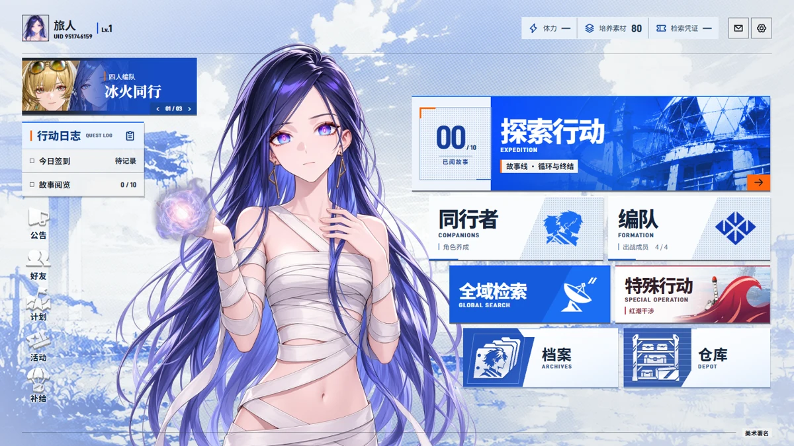
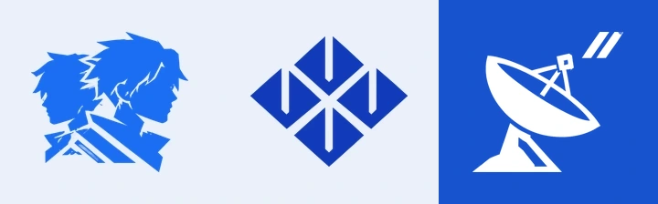
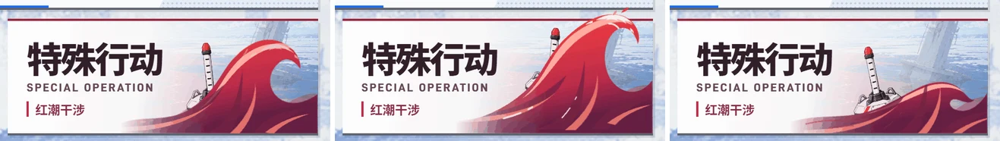
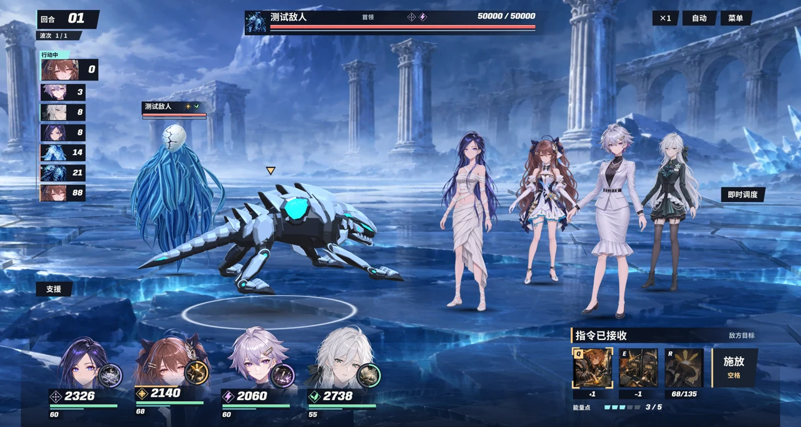
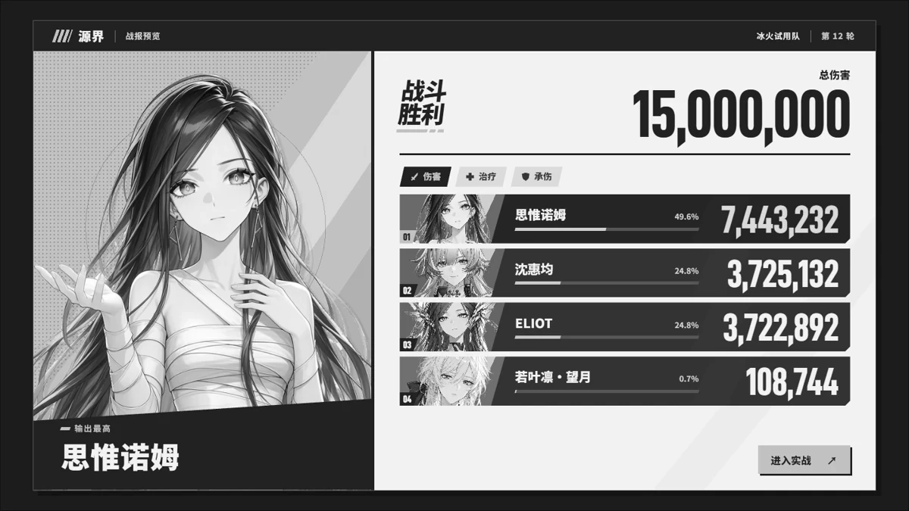

# 《源界》美术与 UI 设计手册

2026 年 11 月 20 日 · V1.0 · 供界面设计、美术出图、前端、Unity 和后续接手人使用

《源界》是一款以后启示录世界为背景、围绕同行者展开的四人回合制游戏。玩家在主页先见到自己选择的人，在战斗中判断下一步行动，在战报里看见这一队打出了多少伤害。三处的视觉重心随玩家正在做的事而变。

**已明确的美术方向**是明亮冷调、平面赛璐璐、成套剪影图标、扎实的中文和数字，以及看得出厚度的材质。主页用白、浅蓝和钴蓝，红色局部介入。**战报现有黑、纸白、暖黄配色待改。** 战报的最终配色仍待确定。下文引用现有色值、尺寸或动效周期时，指向的都是具体实现；只有玩家反馈中明确认可的部分才作为后续依据。

## 1. 怎样读参考图

| 设计问题 | 参考方向 | 借鉴时具体看什么 |
| --- | --- | --- |
| 为什么平涂也显得扎实 | 《明日方舟》《战双帕弥什》的平面界面 | 缩小后还剩下哪些剪影，文字压在哪块明暗面上，连续几个入口用什么共同特征维持一套视觉语言。 |
| 为什么战场元素多却容易读 | 《新月同行》的战斗页 | 看一次选敌、一次增益生效和一次退场。记录提示出现在哪里，什么时候最亮，如何给下一次行动让位。 |
| 怎么读清一次行动的结果 | 《崩坏：星穹铁道》的战斗与命中反馈 | 看目标、数字、属性标记、爆发演出的先后顺序。选实战帧，主页截图回答不了选敌问题。 |
| 后启示录在日常界面怎么体现 | 用户提过的《鸣潮》式世界气质，以及《源界》已有红潮、检索、浮标、档案等题材 | 想象幸存者拿什么收讯、怎样记录异常、在哪里存放东西。让功能本身长出图形，再确定剪影。 |

借一张图之前先说清它解决哪个问题。一张概念稿可以借构图张力，另一张可以借图标，第三张只借材质。用户夸某一处时，把那一处记下来。**「做得快」「这个界面有审美」「先用着」各有含义，不能据此把页面上的每个决定写成定稿。**

## 2. 「平」「实」「有重量」怎样落在画面上

- **平。** 用轮廓、遮挡、硬边阴影和大色面画出层次。拿掉渐变还能认出图案，补上高光后才看出它是哪种材料。赛璐璐人物可以有丰富的发束、衣褶和饰件，到了按钮尺寸，首先读到的仍是脸、手势或器物的大形。
- **实。** 文字笔画有实心的中心，颜色与底面拉开。物件边缘清楚，图标内部的洞在原尺寸还开得出来。白字需要发亮时，保留清晰字面，把亮边放在局部。整层降低透明度会把字、底边和图形一起洗淡。
- **有重量。** 想清楚物件朝光的一面、背光的一面、压住的底面在哪里。按钮底下短短的一道冷灰厚边，往往比一圈宽光晕更能交代厚度。按下时面板向厚边靠近，松手复位，玩家能感到这块东西被按动。
- **紧凑。** 同一件事所需的信息靠在一起。头像、属性、当前血量组成一个角色状态组；技能图、能量和确认提示组成一个指令组。两组之间留出战场。若每个角落都放一块等大的面板，眼睛会在四处来回找。
- **有张力。** 一个大形压住版面，旁边有几块小形与它相接。允许立绘发梢、局部浪尖越出边界。辅助图形沿已有轴线排布；每加一道斜切，都看它是否划分了信息、指明了方向或露出了下层材质。

快速判断可以先截一张正常游玩尺寸的图，眯眼看，再转成灰度。若第一眼只剩蓝色装饰带，调小它的面积；若人物和功能仍清楚、文字却消失，先修字重、底面和字号。

## 3. 色彩、面积与材质

### 主页用色

| 色彩职责 | 当前工程取样 | 使用位置与分量 |
| --- | --- | --- |
| 白、纸白、冷白 | 厅内底色 `#F3F5F6`，通用纸白 `#F5F9FF` | 承托立绘、功能面板和留白，大面积使用。人物在深发、浅发、白衣几种情况下都需要轮廓。 |
| 浅蓝、雾蓝 | 页面底 `#DCEAFB`，蓝灰分隔 `#A8BBD3` | 拉开远近、界定底板。饱和度低于主入口，避免背景与人物发光部位争亮。 |
| 钴蓝、深蓝 | 厅内主蓝 `#0A4BFD`，通用蓝 `#2051B8`，墨色 `#121E30` | 蓝色给主入口、选中态和少数大图形；深色优先给字面和边缘。若每个按钮都铺满蓝，主次就消失了。 |
| 红、珊瑚红 | 通用红 `#C22245`，潮水另有自己的色阶 | 放在红潮、异常和确需提示的局部。红潮从白蓝界面的一角侵入，旁边的平静区域赋予它异常感。 |
| 信号橙 | 厅内交互色 `#FF650D` | 现版用于小箭头等动作提示。保持小面积，避免主页往黑橙枪战界面偏移。 |

色值是从当前样式取的工作起点，具体画面还取决于颜色占了多大面积、挨着谁。给新界面上色时，先看整屏白与浅蓝是否连贯，再决定哪一块值得用钴蓝。角色固有色、技能属性色和危急状态各有含义，保留玩家对它们的识别。[主页样式](../lobby/lobby.css)

### 三种常用材质

| 材质 | 表面、边缘和光 | 放在哪里 | 实际检查 |
| --- | --- | --- | --- |
| 透白抛光、近白玉 | 正面保持白，局部略透底色。迎光边窄亮，侧边略暗，底部有短接触影。转折处最亮。 | 悬浮快捷图标 | 放在亮天空、蓝色背景和人物衣服旁各看一次。浅底能读出轮廓，深底能读出通透。整枚染青灰会偏离用户对「玉石」的指向。 |
| 烤漆金属 | 大面颜色均匀，边缘有细小高光，下沿露出一层较深的漆面或基底。按压时厚边收窄。 | 可按的主功能板、档案与仓库的硬质部件 | 关掉动画，仍能看见受光方向和可按的厚度。多块相邻材料应共享光向。 |
| 印刷图形与哑光底板 | 实色墨块、干净负形、短而清楚的印边。网点或纹理只出现在需要交代材质的地方。 | 图章、信息区、次级底板 | 缩小后纹理先消失，主体最后消失。把纹理叠到汉字上造成笔画断裂时，退回底面。 |

现版白玉图标把剪影作为遮罩，正面填白，边缘做窄高光，下方错位生成侧边和接触影。后续换「计划」剪影时可以沿用整套受光。透明轮廓与材料分开，也方便同一枚图标做禁用、焦点和按下状态。[主页中的材质定义](../index.html)

## 4. 主页构图与十个功能入口

**16∶9 横屏是设计起点。** 先给看板角色的眼睛、脸和手部留出呼吸空间。背景提供空气和明暗分区，可以是弱化的天光、远景或地貌。换一位同行者后，这个地点依然属于《源界》的公共大厅。当前实机图用于看体量与位置，背景细节密度仍可调整。

| 功能 | 玩家来做什么 | 主页的处理 |
| --- | --- | --- |
| 探索行动 | 继续主线、支线、地区或常规行动 | 最大的交互模块。标题、当前内容和进度放在一处，玩家能直接找到下一步。进度名与数据口径相符，例如「已阅故事」。 |
| 同行者 | 查看并培养角色 | 主要次级入口。两位人物的侧影能传达「人」。培养中的技能、频谱、模组、升格和档案留给内页。 |
| 全域检索 | 在角色卡池中检索 | 用接收天线与短促收讯反馈表达搜寻。罗盘容易让人读成地图或导航。入口名称沿用「全域检索」。 |
| 编队 | 选择四位成员，调整阵容 | 用四席结构表达数量和关系；已上阵人数紧跟标题。同一角色的头像与养成页、战斗页保持可辨。 |
| 特殊行动 | 进入红潮异常或高难挑战 | 保有独立的异常图形。让局部侵入边框，标题、热区和相邻入口仍清楚。当前试作位置和动效见第 7 节。 |
| 计划 | 查日常、周常、成长目标和奖励 | 主页快捷名称用「计划」。放左侧竖排，名字在图标下。 |
| 活动 | 进入限时内容 | 左侧图标提供稳定入口，宣传位可以指向当前活动。轮播换图时，核心功能仍在原位。 |
| 档案 | 查人物、地区、组织与已解锁剧情 | 用能联想到翻阅、归档的剪影，属于次级入口。维持和仓库一致的字面、对齐和材料。 |
| 补给 | 购买或兑换资源 | 快捷列中的补给符号应与仓库能区分。动作是领取或交换，构图可体现交付。 |
| 仓库 | 查已有材料和物品 | 用收纳、储存的结构表现，与档案成对。图标内部可有足以说明物件的次级细节。 |

玩家头像、昵称、等级、UID 和经验归到左上玩家区。体力、货币或检索凭证归到顶部资源栏。**公告、好友分别占左侧竖列的一行**，与计划、活动、补给统一光向和视觉中心，标签都在图标下方。垂直对齐看图形的视觉重心，过长的天线或尖角不应把主体挤歪。邮件、设置保留明确的点击与焦点反馈。

## 5. 怎样画出同一套二游图标

三枚样张的共同点是**大块实色、带方向的外轮廓、少量有意义的内部切口**。同行者靠两张脸的错位读出人物关系；编队靠四块重复形和中央交点读出队列；接收天线靠碟面倾角、馈源和支架读出设备。即使都变成单色，这三种用途仍然分得开。[原始透明素材](../assets/lobby/survey-marks/)

1. **写一个物件和一个动作。** 例如「接收天线正在锁定信号」。如果只能写「科技、炫酷、几何」，外形还没有依据。
2. **先画最小可识别剪影。** 缩回主页实际尺寸，用纯色并暂时盖住名称。看两个人会不会并成一团、四席会不会少一席、天线的支架会不会糊成线。
3. **选能交代结构的细节。** 切一刀形成肩与下巴的分界，或露出支架之间的空隙。需要更复杂时，先加这类信息，再看还有没有地方容得下纹样。
4. **整套并排校光、校重。** 外框同尺寸时，实心方块往往比细长天线显大。按可见面积和视觉重心调整，各枚主体有相近的分量。
5. **按用途交付。** 轮廓能稳定重画、需变色或分层动画时可用 SVG。生成得好的剪影直接保留透明 PNG；把位图包进 SVG 也仍按位图的清晰度验收。透明图在黑、白、蓝三种底上检查白边、残灰和裁切。

**菜单图标与技能插画各有颗粒度。** 菜单要远看能认；技能图标可以是一张完整的小画，允许平涂赛璐璐的动作、手部、器物和工业细节。工业符号与角色技能插画两条方向都值得保留。比较两版时改变主体或镜头，例如「角色手部启动装置」和「装置内部剖面」，轻微换色很难让人做出选择。

## 6. 字体、数字与可读性

中文功能名承担读图的第一层。实心粗字和明确的明暗反差先立住，英文副标再补身份。英文缩小、加一点字距即可；一行大中文、一行英文、一个必要状态通常足够。长角色名、长章节名放入真数据验排版。压缩空间时，先让装饰、次要英文和多余留白让位。

主页现有 `HallSans`、`HallSerif` 和 `DIN`，仓库含中文黑体、宋体、窄体数字及多种字重。功能文字优先取清晰的中文黑体；宋体适合有叙事目的的标题或人物表达；生命、能量、回合和伤害数字需比较宽度、斜体辨识度及千位分隔。看最终渲染的笔画，尤其是手机缩放后的「潮」「徽」「凛」。[项目字体](../fonts/)

战斗状态字需要「亮且实」时，给字心足够亮度，再用局部暗底或细边与场景分离。若白字在冰面上消失，先改字背后的明度；若数字在七位数时挤到角色名，给数字列足够宽度并保持末位对齐。两种问题都不能只靠加粗或加光解决。

## 7. 动效与光效

每个动效都应能用一句动作描述。接收器捕获信号，浮标响应潮水，血槽记录一次扣血。设计静止、变化最大的一帧、结束三种状态；在最大变化处检查标题和点击区，在结束处检查能否自然接回下一轮。

**红潮突破 UI 是用户提出的方向。** 图中为当前实现样张，最终造型仍待审美确认。现版在一个约 4.8 秒的循环里分别控制后浪、浮标、浪体轮廓、白沫、水滴和退潮纹。浮标迟一拍发生倾斜，浪峰经过上沿时少量水花越界，回落后重新露出浮标。把几个物体编成有前后的动作，就能看出异常在影响这块界面。再打磨时先看浪尖有没有卷落感、浮标有没有吃水，再决定是否需要更多颗粒。

**其他动效沿各自的物理或交互逻辑。** 全域检索适合短暂收讯、定位收紧，再回待机。白玉图标在聚焦时可以让受光边轻微变化。用户多次指出重复扫光有路径依赖；给一排图标同时加白线横扫，会让每个按钮都像在报同一种状态。按下反馈应及时，常驻循环给角色留出静止时刻。

主页已提供静态偏好，红潮和收讯可在弹窗时暂停。新特效检查减少动态效果设置、键盘焦点和触屏点击，动画越框部分避免拦截相邻按钮。性能在实际页面看，用普通设备观察长时间待机和多次进出页面后的表现。

## 8. 战斗 HUD 与角色演出

战场人物的原画配准、拆层补图、肩肘腕绑定、实际修复图例及 Unity 导出流程见[人物战斗立绘制作与修复](人物战斗立绘制作与修复.md)。

此图用于看区域关系。敌方生命、当时的编队和画面的细节属于截图那一版。以 1920 × 1080 战斗舞台检查全图，再用实际手机横屏和桌面窗口看文字、数字及命中特效。

| 玩家此刻要看什么 | 画面怎么配合 | 实战检查 |
| --- | --- | --- |
| 谁行动、选中了谁 | 行动顺序聚成一列，选中标记贴住敌人；标记的局部亮边和运动区别于战场背景。 | 连续切换相邻目标、镜头推近再拉远，观察标记有没有滞留或挡住敌人。 |
| 队友是否危险 | 左下四人状态组位置稳定。头像、属性标、生命数字和血槽属于同一人。血槽有暗底、填充和扣血后的短暂残影。 | 满血、半血、濒危都看一次；看冰面和深蓝场景上最浅的属性标，还能否一眼辨出。 |
| 增伤、防御或克制是否生效 | 短提示靠近相关角色或目标，字心亮，边缘清楚；持续状态留下图标或层数。 | 同次行动有多种提示时，读完一次增伤提示还能找到目标和下一项指令。 |
| 现在能放哪个技能 | 普攻、战技、终结技用可辨的技能画面和稳定槽位，区分可用、选中、资源不足。 | 真角色逐一进场，尤其检查终结技已接正式图标，点击与键盘提示能对应。 |
| 谁放了终结技、造成什么结果 | 侧边角色／技能提示可承接爆发瞬间；演出结束后把焦点交回战场与伤害。 | 比较手机视频和桌面 Unity 实际播放尺寸，检查素材、视频版本、取样与显示分辨率。 |
| 一次行动有多段命中 | 一次施法承载主体特效，逐段保留轻量命中、数字与需要的状态反馈。 | 用 ELIOT 多段行动连续打几个回合。每段伤害都读得见，整套冰霜大特效也不会按段重新堆满画面。 |

调位置时，网页 HUD 中用户能读清的队伍栏尺寸可作基线。Unity HUD 实际绘制后再接管同一组信息。第一次进入、刷新和完整加载后都看一遍，防止网页与 Unity 两份状态栏叠在一起。伤害数字、状态和触发次数读现有战斗事件；视觉节流也应保留所有实际命中结果。[原生 HUD 切换](../battle3d/native-hud.js) · [Unity 战斗反馈](../unity/Battle/Assets/BattleHud.Feedback.cs)

## 9. 伤害结算页

**战报的黑、纸白、暖黄是尚未来得及修改的旧配色。最终配色待定。** 上图特意做了灰度处理，便于看字重和面积。图中 15,000,000 是预览页的样例总伤害。讨论战斗强度时需读取当局实战数据。

打开战报时，玩家应先看清队伍总伤害，随即能比较四人的数值。当前预览中，思惟诺姆一行是 7,443,232，沈惠均与 ELIOT 都在 370 万左右。玩家应该能直接分清后二者的差距，无须靠长度接近的进度条猜。角色名和数值同行，数字靠同一右边界，百分比和条形辅助比较。切到治疗或承伤，标题、排行、总值和代表人物随同一个指标变化。[战报预览](../battle3d/report.html) · [数据与排序](../battle3d/operation-report.js)

右半边是用户点名需要减轻「AI 感」的区域。排版先给四行真实数据和各自头像留位置，再决定分割方式。角色脸的裁切和大号数值自带识别度，给每行叠同样的角标、编号、斜切和英文，会增加四次相同的视觉噪声。重做配色时，在**总伤害、多位数的可比性、四人贡献一眼可读**这三项上做前后对照。

## 10. 看板、养成与出图交付

看板立绘挑脸、眼睛和手势清楚的构图，给周围功能预留空间。换人会改变发色、服装亮度、角色宽度；用深发浅衣、浅发、带大型饰件的角色各试一次。眨眼图与睁眼图共用相同画布、眼位和裁切；呼吸网格只做轻位移，避免整张立绘像气球起伏。沈惠均与 ELIOT 已有闭眼版本，可作为这类素材的制作参照。[养成页立绘呼吸实现](../charui/portrait-breath.js)

**技能出图按一人一组。** 一次生成可在同一张里排该角色的普攻、战技、终结技三幅独立画面。每格保留裁切边距、独立构图和足够清晰度，导出三个独立文件。需要四格的素材可以用 2 × 2。频谱数量、技能和终结技使用哪张图，以角色配置和用户最后一次更正为准。源图保留无损版，运行资源再按实际尺寸导出。

可复用的出图说明，替换方括号中的内容即可。

> **一组菜单图标**　为《源界》画三枚同系列的后启示录行动终端图标，[物件 A]、[物件 B]、[物件 C]，每格一个。参考《明日方舟》的平面图形组织。用实色剪影和有结构含义的负形交代功能，三枚统一光向、视觉重量和切角。透明背景，四周留出完整可裁切边距，文字由界面另排。小尺寸也能认出各自的物件。
>
> **一位角色的三张技能画**　为[角色]创作普攻、战技、终结技三格独立小画。[填三种具体动作、器物或力量形态]。保持人物与本作素材一致，平涂赛璐璐、硬边明暗、清楚的工业或角色细节。三格分别安排主体，终结技有最大的动作幅度。格间留切割带，保留边缘，导出后在技能栏大小辨识。
>
> **可动画的特殊行动资产**　提供平静水面、卷起的浪尖、单独浮标、少量飞沫，各物件可拆层。固定同一光向和透视，分别给前景、后景留遮挡余地。涌起与回落都能露出浮标的一部分。标签、标题、按钮和点击区域由界面绘制。

做风格比较时给出同一功能、同一显示尺寸、同一背景下的候选。若要求全新方向，从独立构图出发，不在前一张原画上反复微调。若反馈只是「移位置」，沿用原图、材质、字号和状态，只调整位置与对齐。

## 11. 网页与 Unity 的接手位置

| 要改的画面 | 从哪里读 | 改后从哪儿看 |
| --- | --- | --- |
| 大厅、看板、菜单与按钮 | [主页结构](../index.html)、[大厅样式](../lobby/lobby.css)、[大厅交互](../lobby/lobby.js) | 正常进大厅，换一个看板，打开入口，再退回。 |
| 图标与材质 | [三枚主入口样张](../assets/lobby/survey-marks/)、[功能图标集](../assets/lobby/field-marks.svg)、主页中的材质遮罩 | 先并排看透明素材，再看它压在真实背景上的效果。 |
| 角色立绘、技能按钮 | [养成界面](../charui/)、[Unity 指令 HUD 素材](../unity/Battle/Assets/Resources/CommandHud/) | 在角色养成页和战斗操作态同时看裁切、大小与命名。 |
| 战斗画面与指令 | [战斗入口](../battle3d/index.html)、[战斗呈现](../battle3d/play.js)、[Unity HUD](../unity/Battle/Assets/BattleHud.cs) | 打开 Unity 战斗实机，等待画面与 HUD 加载，实际选敌、放技和结算。 |
| 战报 | [战报样式](../battle3d/operation-report.css)、[战报逻辑](../battle3d/operation-report.js) | 用预览页处理排版，用真实对局核对数据。 |

大厅、养成和战报有网页实现，战斗已有 Unity 舞台和原生 HUD，并与网页侧状态衔接。现在做主页材质、动态剪影或字体可以直接复用网页能力。后续迁移战斗时，要带走的是视觉层级、状态、尺寸与事件对应关系。历史交接记录可用于查旧布局，当前代码和实际入口更能反映现在由哪一层绘制。

## 12. 评审与下一次改版

| 听到的反馈 | 第一项检查 | 能交给用户看的证据 |
| --- | --- | --- |
| 「太虚，左下角都看不见」 | 在实际视窗检查字面、图标实心面积、底面反差、画布缩放。 | 完整战场图，附同一帧左下局部。 |
| 「像劣质小游戏」 | 遮住名称，检查图标是否混用了不同光向、线宽、题材和材质；再看整屏第一视觉落点。 | 一排同尺寸图标和放回主页后的整屏。 |
| 「太简约，再复杂一点」 | 找出能补充功能含义或角色身份的第二层信息。 | 同一小尺寸下两套构图，能说清差别。 |
| 「太解构、颜色看累了」 | 看钴蓝色块占比、斜切次数和相邻模块是否都在争夺注意力。 | 全屏缩略图，附一张灰度图看面积。 |
| 「只有贴图，特效不好看」 | 观察主体、受影响物、余波是否各自发生变化，运动是否有前因后果。 | 从真实页面录下完整循环，包含回落和静止。 |
| 「只让你移位置」 | 对照调整前的组件、材质、命名和状态，收敛修改范围。 | 同尺寸前后图，方便只比较位置。 |
| 「伤害太小」 | 看数字与胜利标题的面积关系，检查四行长数字是否能直接比较。 | 带千位分隔的百万级数据、零值、手机窄屏各一例。 |

提交画面前，按改动范围选实际情景走一遍。大厅可用 1440 × 810、844 × 390、390 × 844 和 320 × 640 观察主次、边缘和重排；战斗观察实际桌面与手机横屏；战报用最长角色名和多位数。动态反馈录一段完整过程，静态效果留全图，让用户能在平时玩的距离判断。

**当前仍开放的美术决定**包括战报的最终色彩、红潮浪形的最终表现，以及不同角色选用工业符号还是小幅技能插画。以后收到明确反馈，更新对应章节并标注日期。截图说明它曾经是什么样，用户的原话决定哪些部分值得延续。

## 13. 从实机和返工里学到的事

按现象回查字体、素材、战斗联动、服务、旧引擎和仍待实机确认的项目，可直接翻[《源界》已知踩坑与避雷记录](源界已知踩坑与避雷记录.md)。

### 美术判断

- **「像玉石」要先翻译成能画的细节。** 第一次把图标染成青灰，改动落在了色相上。用户指的是白色表面略透、转折处有亮边、底部有分量。下次碰到「玉石」「烤漆」这类词，先把同一枚图标的剪影和颜色固定，只改变透光、侧边和接触影。两张放回同一处背景，才容易看出哪种处理有效。
- **比较 A、B 时，差异要经得起缩小。** 两张赛璐璐技能画的大形和镜头太接近，用户看上去几乎一样。给同一个技能做两个方向，可以一版画人物手部施术，一版画装置启动的瞬间。先裁到实机按钮大小，再决定值不值得把两个方向都精修。
- **一次反馈只给它实际涉及的部分定性。** 用户夸过战报的审美，也单独要求把伤害做大，后来明确说明黑、纸白、暖黄还没来得及改。交接记录可直接写成「四人伤害需要一眼能比，旧配色待改」。用户只要求把公告移到左侧时，保留一张旧截图，调整后逐项核对位置、材质、字号和标签。

### 实机排查

- **红潮会动，浪尖却可能没动。** 在一次实现中，浏览器读到轮廓动画的路径值在变化，浮标与水滴也在动。把起浪、峰值、退潮三帧并排后，才发现屏幕上那道浪尖停在同一高度。把变化的路径直接放进实际裁出水面的 SVG 裁切区，再拍相同三帧，浪尖才确实越过边框并退回。以后查这类问题，盯住一个可测的部位，例如浪尖相对按钮上沿的位置；整张图的像素有变化，只能证明画面某处在动。
- **立绘只在抬手时破，先看动作。** 思惟诺姆的右肩曾被当成贴图清晰度问题。用同一张贴图停在静止、半抬手、最高点，断口随动作出现，排查才落到肩轴和蒙皮权重。另一个常被形容为「糊」的问题是大招在手机和桌面观感不同。那种情况先截同一时间点，记录源视频尺寸、播放区域和渲染分辨率，能少走一轮重出原画的弯路。
- **多段角色要完整打完一手。** ELIOT 的冰霜演出，单看第一段只能评画面。要观察卡顿，记下一次行动的伤害段数、主体冰霜创建次数，以及最后一段时屏幕上还留着几层。主体演出按行动检查，命中和数字逐段核对；这一组记录能帮助决定该减轻哪层开销，也能发现漏掉的打击反馈。
- **同一个战场入口有加载时序，也有输入焦点。** 稳定后的截图会漏掉网页 HUD 向 Unity HUD 交接时的重影。复查时从刷新开始录到可操作，再分别点一次网页按钮和 Unity 战场，试同一组选择与确认键。这样既能看到哪一帧两层同时出现，也能发现点击战场后按键失灵或执行两次的问题。[HUD 交接实现](../battle3d/native-hud.js)
- **改完能看到，还要留意下次生成。** 项目曾从 V6 模板生成战斗页，直接编辑生成页的改动可能在重建时丢失。接手旧战斗页面时，先查改动的节点有没有生成来源，再针对实际改动走一次相关生成流程，对照差异。那一版的模板关系、输入焦点和右肩排查都有记录。[战斗 UI 历史交接](HANDOFF-ui-2026-11-19.md)
